# FLOST8 Bookings: Owner Guide

For Anuda. Plain and simple. Every step here matches what the app does today.

The pictures use made-up names and numbers. Your screen will show your real bookings.

---

## QUICK CARD (read this first)

**What this app is.** One place to see every booking enquiry for your artists. It shows what needs a reply, who owes money, and what is coming up. Kasuni and Nirbheeth work in it too. You see everything. They see only their own artists.

**How to sign in.**
1. Open the FLOST8 site and go to the page called **/manage**.
2. Tap **Continue with Google**.
3. Pick your Google account.

If you see **NO ACCESS YET**, that Google account is not on the list. Use the account you gave your developer.

**The 5 things you do every day.**
1. Open **Overview**. Look at the four tiles.
2. Open **Team follow-ups**. See what each manager still has to do.
3. Tap **Done** on follow-ups that are finished.
4. Tap **Nudge** to remind a manager on WhatsApp.
5. Check the **Calendar** and add any new event.

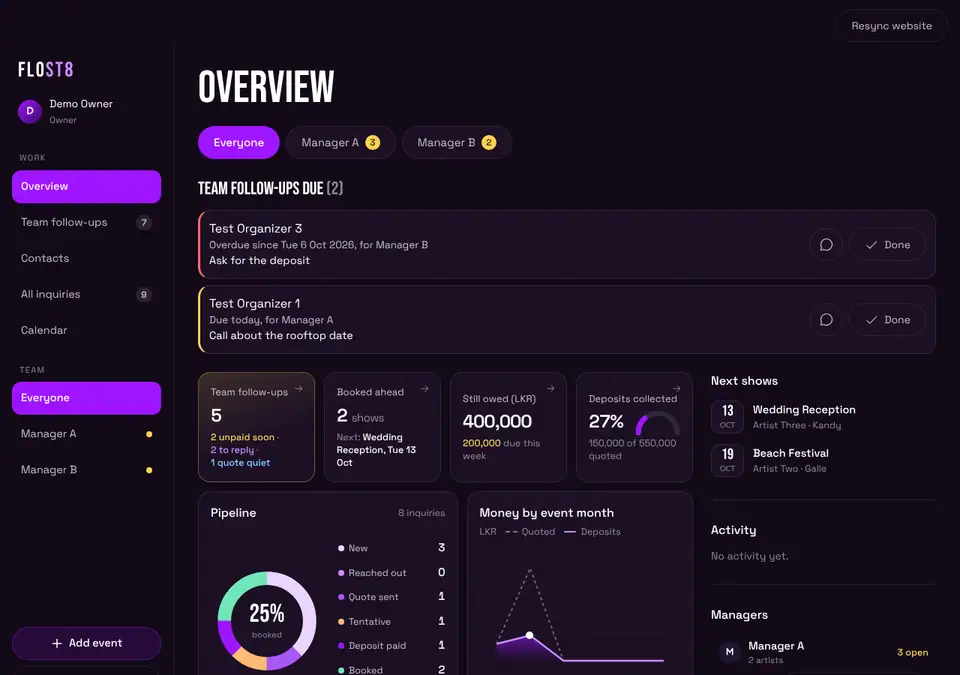

**Three things to know.**
- Most taps can be undone for 5 seconds. Look for the **Undo** button at the bottom.
- Rows marked **From sheet** are read-only. To change one, change it in the sheet, or tap **Edit event** on that one row to move it into the app (section 17).
- Only you and the manager who looks after an artist can see the money for that artist.

---

## 1. Sign in and move around

**What it is for.** Get in, and know where things are.

**What to tap.**
1. Go to **/manage**. Tap **Continue with Google**.
2. Choose your account.

**What you will see.** The **Overview** page.

- On a laptop the menu is on the left: **Overview, Team follow-ups, Contacts, All inquiries, Calendar**.
- On a phone the menu is the bar at the bottom: **Overview, Follow-ups, Contacts, All, Calendar**.
- Near the top are round buttons: **Everyone**, then one for each manager. Tap a manager to see only that manager's work. Tap **Everyone** to go back.
- **Add event** and **Sign out** are on the left (laptop) or at the top (phone).
- The app remembers the page you were on and your filters, on that device.

**If it goes wrong.**
- **NO ACCESS YET**: your email is not on the list. Ask your developer to add it.
- A grey **Loading** that never ends: check your internet and refresh the page.

---

## 2. Overview and its four tiles

**What it is for.** A quick look at the whole business.

**What to tap.** Open **Overview**. Tap any tile.

**What you will see.**

| Tile | What it shows | What happens when you tap it |
|---|---|---|
| **Team follow-ups** | How many events need a manager | Opens the **Team follow-ups** list |
| **Booked ahead** | Booked shows coming up, and the next one | Opens **All inquiries** showing upcoming booked shows |
| **Still owed** | Money still to collect | Opens **All inquiries** showing upcoming booked shows |
| **Deposits collected** | How much of the quoted money is paid as deposit | Opens **All inquiries** showing upcoming live inquiries |

Under the tiles you will also see:
- **Follow-ups due**: reminders that are due today or late, with the manager's name.
- **Pipeline**: how many inquiries are at each status.
- **Money by event month**: a small chart.
- **Team follow-ups**: the four most urgent items. Tap **View all** for the rest.
- On the right: **Next shows**, **Activity**, and **Managers** (this is where **Nudge** lives).

The number next to **Team follow-ups** in the menu can be a little higher than the tile. The menu also counts follow-up reminders that are due.

**If it goes wrong.** If a number looks too low, check you are on **Everyone** (not one manager).

---

## 3. Team follow-ups

**What it is for.** See what each manager has not done yet.

**What to tap.** Tap **Team follow-ups** in the menu (or the first tile).

**What you will see.** Cards, most urgent first. Each card shows the artist, date, city and the manager's name. It has one line that says what to do, for example:
- **Reply to a new inquiry**: the inquiry is **New** and has had no touch for more than 24 hours.
- **Follow up on quote**: the status is **Quote sent** and nothing has happened for more than 5 days.
- **Chase money**: the show is **Booked** or **Deposit paid**, it is within 14 days, and money is still owed.

Each card has one big button (like **Reply on WhatsApp** or **Chased today**) and a **three dots** button for more. The three dots menu can hold: **Call**, **Chased today**, **Mark reached out**, **Mark paid**, **Set status**, **Snooze**, **Duplicate** and **Open details**. You only see the ones that fit that card. **Chased today**, **Mark reached out**, **Mark paid**, **Set status** and **Snooze** can be undone for 5 seconds.

A card goes away when someone acts on it (a comment or a status change). A **Tentative** date never shows here. A date that is already past never shows here.

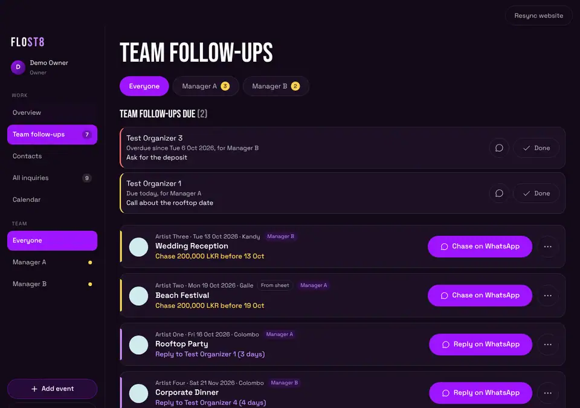

At the very top you may see **TEAM FOLLOW-UPS DUE**. These are reminders that managers set for themselves. Tap **Done** when one is finished.

**If it goes wrong.** An empty page that says **NOTHING NEEDS YOU RIGHT NOW** is good news.

---

## 4. All inquiries and filters

**What it is for.** Find any inquiry.

**What to tap.** Tap **All inquiries**.

**What you will see.** A list split into **Upcoming**, **Past** and **No date yet**. Inside each, there is one bar per month, for example **NOV 2026**, with the number of shows and the total fee. Tap a month bar to open or fold it. Upcoming months start open. Older past months start folded, so tap them to look back. A year that is not this year shows in yellow.

Each show is a card with the date, name, artist, place, status, and money if you may see it. When two or more of your artists play the same show on the same day, they share one card, with one line per artist. Each line keeps its own status, fee and **three dots** menu. A bar at the top shows how many there are and the money totals.

**Filters** (all stay as you left them):
- **My artists** or **Everyone's** (you will want **Everyone's**).
- The search box: event, venue or organizer.
- The artist drop-down.
- **All dates**, **Upcoming**, **Past**.
- Status buttons: **All, New, Reached out, Quote sent, Tentative, Deposit paid, Booked, Lost, Spam**. You can pick more than one.

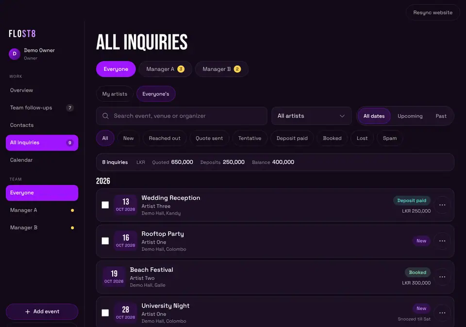

Tap a row to open it.

**If it goes wrong.** **Nothing matches these filters** means the filters are too tight. Tap **Show everyone's inquiries**.

---

## 5. Calendar

**What it is for.** See the month at a glance.

**What to tap.**
1. Tap **Calendar**.
2. Use the arrows to change month. Tap **Today** to come back.
3. Tap a day.

**What you will see.** A month grid. Events are coloured by status. Tap a day. Under the grid you see what is on that day. Below that is a button: **Add event on** that date. Tap it and the **Add event** window opens with that date filled in.

On a laptop, a free day also shows a small **+** button when you point at it.

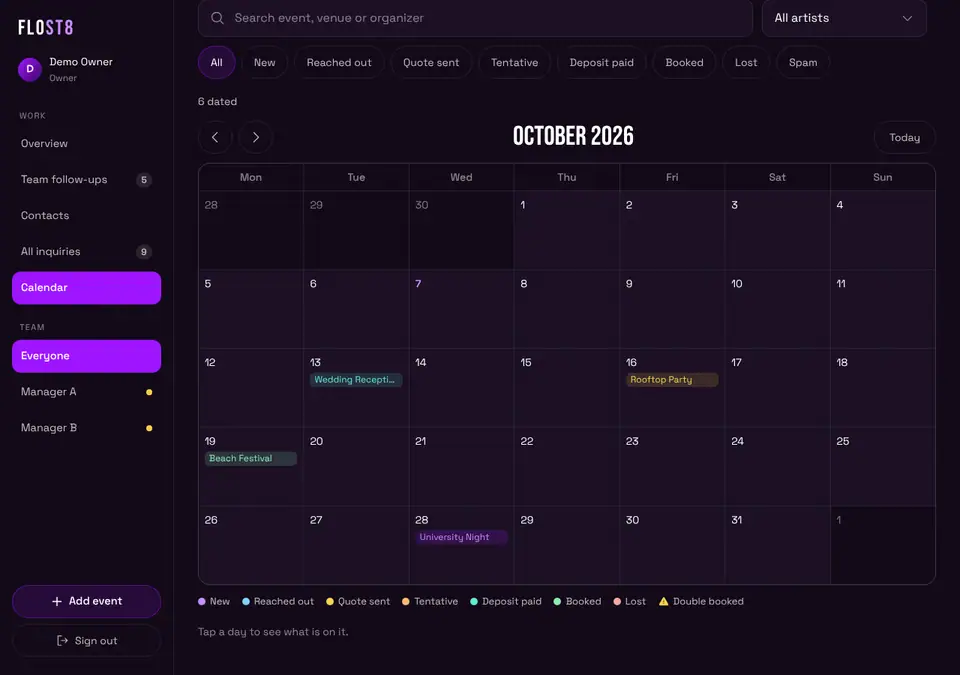

**If it goes wrong.** Calendar uses the same filters as the list. If an event is missing, check the filters.

---

## 6. Add and edit events

**What it is for.** Put a booking in the app.

**What to tap.**
1. Tap **Add event**.
2. Tap the artist (or artists).
3. Pick the **Date**.
4. Type an **Event name** or a **Venue** (you need at least one).
5. Fix the **Status** if it is not right. It starts as **Booked**.
6. Optional: **Set time**, **City**, **Ticket link**, **Fee** and **Currency**.
7. In **Organizer**, start typing a name. Tap a match to fill in the phone, email and more. Or tap **Add "name" as a new contact**.
8. Tap **Add event**.

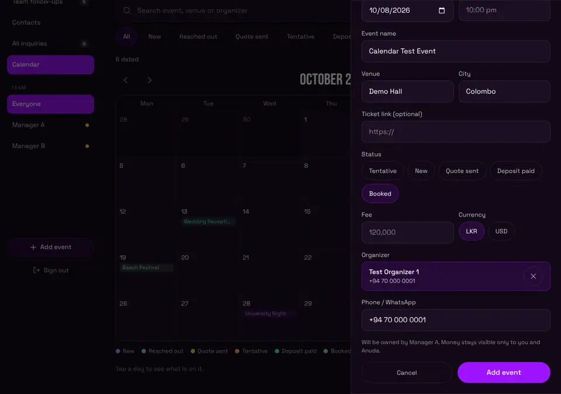

**What you will see.** Before you save, the window says who will own it (the manager of that artist). After you tap **Add event**, the event opens.

**To edit.** Open the event. Tap **Edit event**. This works for events added in the app. A **From sheet** event shows **Edit event** inside the yellow note at the top. Tap it and read the warning first (section 17). In the event you can also:
- Add **Notes**, **Travel notes**, a **Contract link**, and switch **Contract signed**.
- Add money details.
- **Add a comment**.
- **Delete event** at the very bottom. It works on any event: added in the app, from the website form, or from a sheet. It always asks first, and it cannot be undone (section 17b).

**If it goes wrong.**
- **Pick at least one artist.** Tap an artist button.
- **Pick the event date.** Fill the date.
- **Add an event name or a venue.** Type one.
- **You can view this but not change it.** This is a sheet row that you have not moved into the app yet (section 17), or it is not yours.

---

## 7. Change a status

**What it is for.** Move an inquiry forward (or close it).

**Way one, from the list.**
1. Tap the **three dots** on the row.
2. Tap **Set status**.
3. Tap the new status.

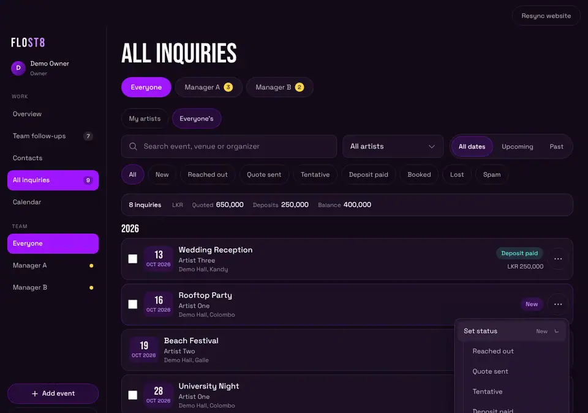

You get 5 seconds to tap **Undo**.

**Way two, inside the event.** Open the row. Tap a status button. A **Tentative** event also has a **Confirm booking** button.

**If it goes wrong.** There is no **Set status** on a **From sheet** row. That is on purpose. Move that one event into the app first with **Edit event** (see section 17).

---

## 8. Snooze

**What it is for.** Hide a row from the follow-up lists until you want to see it again.

**What to tap.**
1. Tap the **three dots** on the row.
2. Tap **Snooze**.
3. Tap **Tomorrow**, **Friday**, or **Pick a date**. (On a Thursday there is no **Friday** button, because tomorrow is Friday.)

**What you will see.** The row leaves the follow-ups. In **All inquiries** it says **Snoozed till** that day. On the day itself it comes back by itself. You get 5 seconds to **Undo**.

To bring it back early: **three dots**, then **Unsnooze**. This happens at once. There is no Undo for it.

As owner, you still see snoozed items on the **Overview**, under **Team follow-ups**, in a dim colour.

You can snooze sheet rows too.

**If it goes wrong.** If you get **Something went wrong**, ask your developer to finish the latest database update (see the list at the end).

---

## 9. Duplicate an event

**What it is for.** Make a new event that is like an old one.

**What to tap.**
1. Tap the **three dots** on the row.
2. Tap **Duplicate**.
3. Pick the new **Date**.
4. Tap **Add event**.

**What you will see.** The **Add event** window opens already filled in. It copies the artists, name, venue, city, set time, fee, currency, organizer and status. It does not copy the date or the ticket link. It does not copy deposits or balances. A copy of a **Deposit paid** event starts as **Booked**, because nobody has paid for the new date yet.

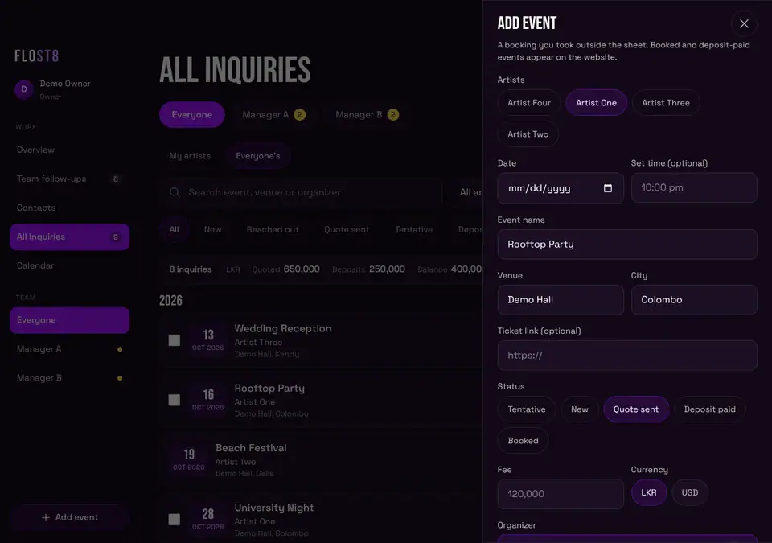

**If it goes wrong.** You must pick a date, or the app asks you to.

---

## 10. Bulk Lost or Spam

**What it is for.** Close many rows at once.

**What to tap.**
1. Open **All inquiries**.
2. Tick the small box at the left of each row.
3. Tap **Mark lost** or **Mark spam** in the bar at the bottom.

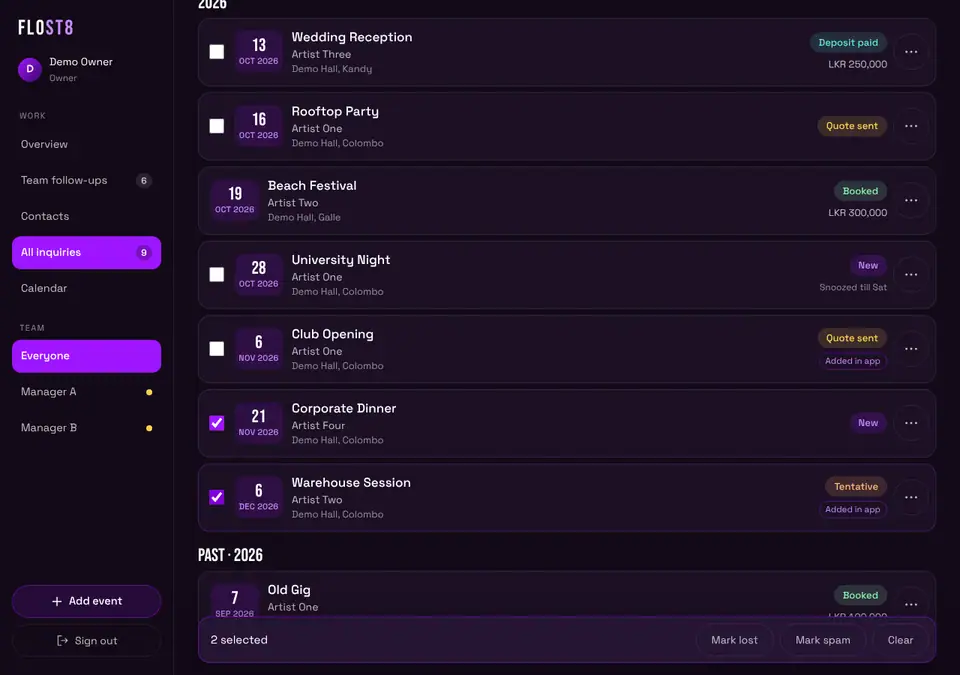

**What you will see.** The bar says how many you ticked. After you tap, you have 5 seconds to **Undo**. Then a message says what happened, for example **7 of 8 updated, 1 not allowed**.

Tap **Clear** to untick everything.

**If it goes wrong.** Rows marked **From sheet** have no tick box. You cannot bulk change them.

---

## 11. Put events on the website (Upcoming Shows) and Resync

**What it is for.** Show your booked events to the public.

**How it works.**
- Events you add in the app with the status **Booked** or **Deposit paid** are sent to the website's **Upcoming Shows** list. This happens on its own when you save.
- Events from the sheets reach the website through the sheet's own sync, not through this button.
- You will sometimes see **Already on the site from the sheet**. That is fine.
- An event can be **held back**. It shows a note in the event: "held back from the website". Only you can tap **Release to website**.

**Resync website.** This button is at the top right (owner only). Tap it to check every app event against the website. It shows **Updating website...** while it works.

**Good to know.** The website step only works when your developer has switched it on. If it is off, saving still works, but the website list does not change. Resync will tell you: **Website updates are switched off right now, so nothing was changed.**

**If it goes wrong.**
- **Saved, but the website list was not updated**: tap **Retry** on the message.
- If it keeps failing, tell your developer.

---

## 12. Contacts

**What it is for.** Keep every organizer and venue person in one place.

**What to tap.** Tap **Contacts**.

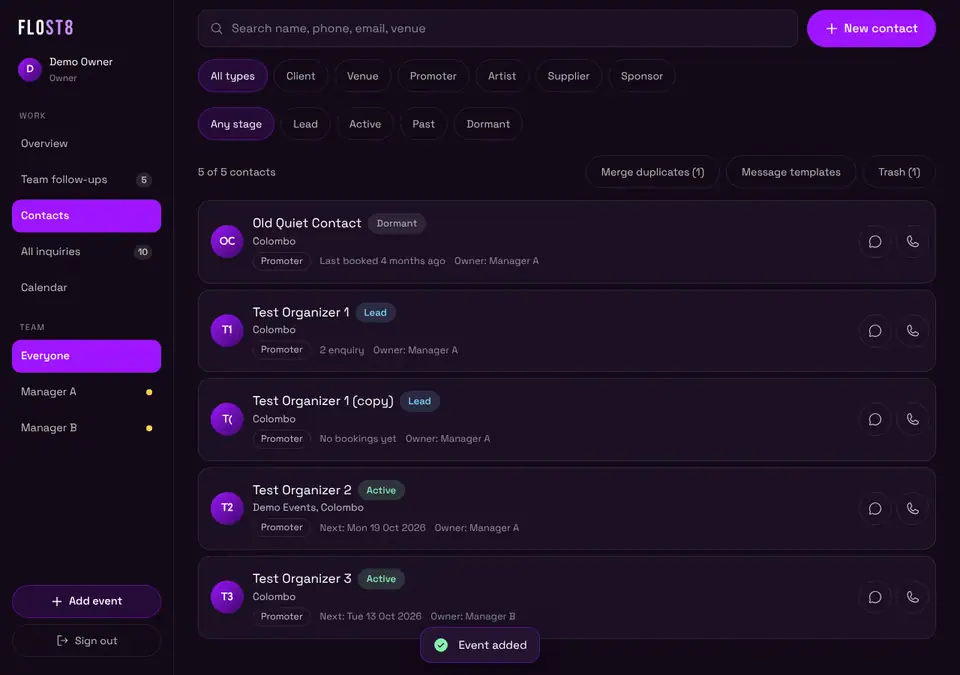

**What you will see.**
- A search box (name, phone, email, venue).
- Filters: **All types, Client, Venue, Promoter, Artist, Supplier, Sponsor**. And **Any stage, Lead, Active, Past, Dormant**.
- **New contact** button.
- Each row has a **WhatsApp** and a **Call** button.
- Rows show **Owner:** and the manager's name.

**Add a contact.** Tap **New contact**. Fill in the form. Save.

**Open a contact card.** Tap the name. The card has:
- **WhatsApp**, **Call**, **Email**, **Edit** buttons.
- **FOLLOW-UPS** (reminders), **BOOKINGS**, **LOG A TOUCH**, **TIMELINE**.
- **Show change history**.
- **Merge with another contact** and **Move to Trash** at the bottom.

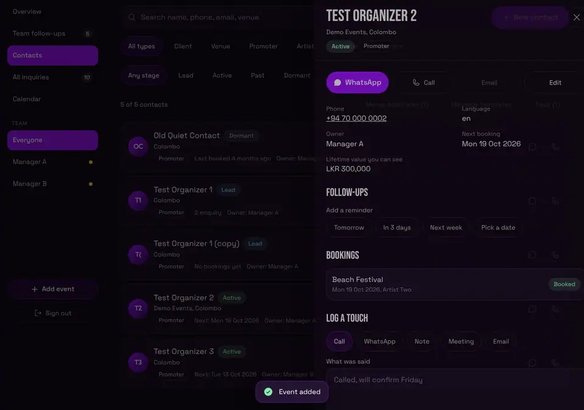

**Merge duplicates.** (Two entries for the same person.)
1. In **Contacts**, tap **Merge duplicates**. The number in brackets is how many pairs the app found.
2. Tap **Review and merge** on a pair. Or use **Pick by hand**: search, tick two or more, tap **Review**.
3. Pick the one to keep (**KEEP WHICH ONE?**). You can change the name.
4. Tap **Merge**.

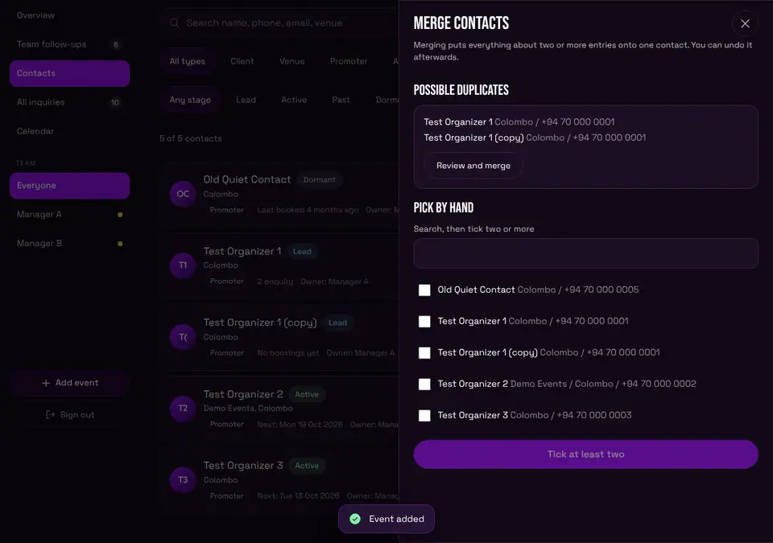

The kept contact gets all phone numbers, emails, notes and bookings. Nothing is erased. The other entries go to Trash.

**Undo a merge.** Right after merging, a bar appears for 20 seconds with **Undo**. After that: open the kept contact, tap **Show change history**, then tap **Undo this merge**.

**Trash.** Tap **Move to Trash** on a card. The contact, its bookings and its notes stay safe. Nothing is erased on its own. After 30 days your developer can clear old ones out for good, so restore a contact before then if you want it back. To get one back: **Contacts**, then **Trash**, then **Restore**.

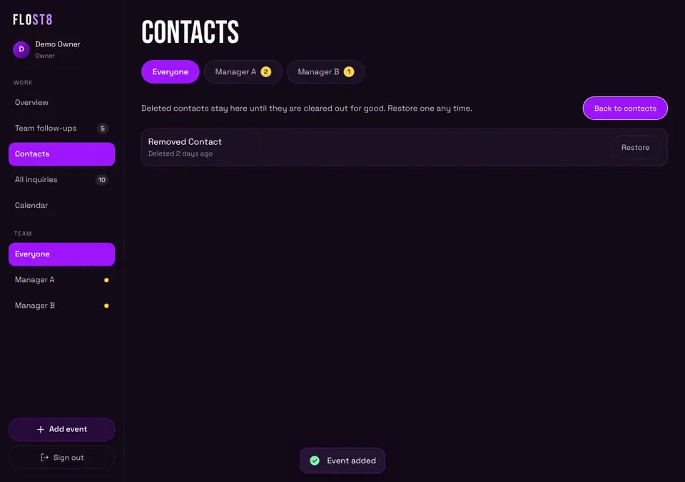

**Delete forever (owner only).** In **Trash**, a contact has a red **Delete forever** button next to **Restore**. Tap it and the window **DELETE FOR GOOD?** opens. If you confirm, the contact and their notes, history and reminders are erased. Events linked to them stay, with no contact. **This cannot be undone.** The button is not shown for a contact that other contacts were merged into. Managers do not see this button.

**If it goes wrong.** If you see **Contacts could not be loaded, so the lists below may look empty.**, tap **Try again**.

---

## 13. Reminders

**What it is for.** Never forget to call someone back.

**What to tap.**
1. Open a contact card.
2. Under **FOLLOW-UPS**, pick **Tomorrow**, **In 3 days**, **Next week** or **Pick a date**.
3. Type what to follow up on (optional).
4. Tap **Set reminder**.

You can also set a reminder while you log a call: under **LOG A TOUCH**, pick **Remind me**.

**What you will see.** On the day it is due, it shows in **Follow-ups due**. Late ones are red. Tap **Done** when finished. The small chat button opens WhatsApp.

**Good to know.** You see your own reminders and your managers' reminders. Each one shows the manager's name.

---

## 14. WhatsApp templates

**What it is for.** Send a ready-made message in a few taps.

**What to tap.**
1. Tap the **WhatsApp** button on a contact or on a follow-up card.
2. Pick a language if there is more than one.
3. Tap a template. The message fills in.
4. Change the words if you like.
5. Tap **Open WhatsApp**. WhatsApp opens with the message typed. You press send there.

The app can also **Copy** the message. If the box **Add to their timeline when I open WhatsApp** is ticked, it adds a note on the contact.

**Make or change templates.** In **Contacts**, tap **Message templates** (or **Edit templates** in the WhatsApp window). Tap **New template**. Give it a title, a language, and a message. You can type `{name}`, `{date}`, `{venue}`, `{event}` and `{me}`. They fill in by themselves. **Archive** hides a template. **Restore** brings it back. Everyone shares the same templates.

**If it goes wrong.** If it says **There is no usable phone number yet**, add a phone number to the contact.

---

## 15. Nudge a manager on WhatsApp

**What it is for.** Remind Kasuni or Nirbheeth about what is waiting, in one tap.

**First, once per manager.** The Nudge button needs the manager's WhatsApp number. You add it once.
1. Open **Overview**.
2. Find **Managers** on the right (on a phone it is lower on the page).
3. Under a manager, tap **Add WhatsApp number**.
4. Type the number. Use digits, with an optional **+** at the start. Spaces and dashes are fine. A number that starts with 0 is read as a Sri Lankan number.
5. Tap **Save number**.

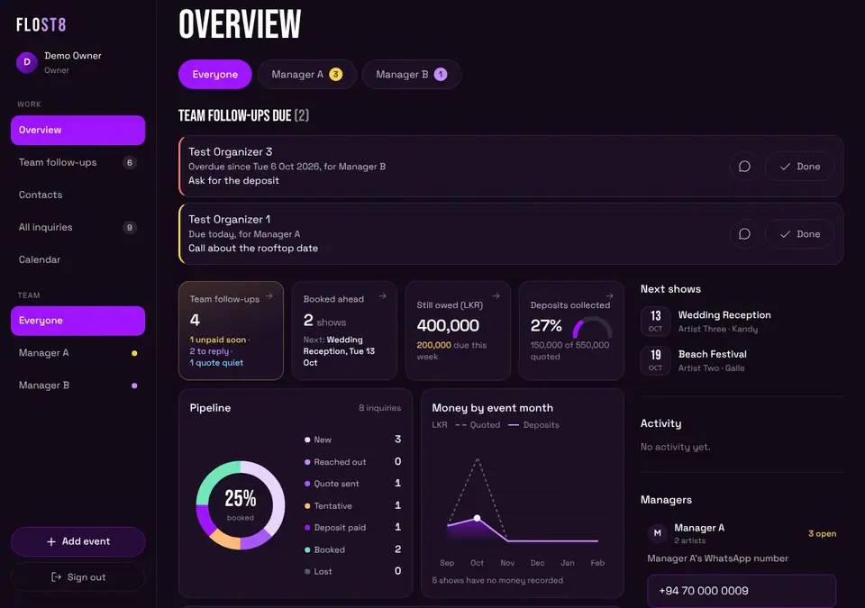

**Then, every time.**
1. Tap **Nudge** under the manager's name.
2. WhatsApp opens in a new tab with the message already written. For example: "Hi Kasuni, 2 things need you: ... Can you pick these up today?"
3. Press send in WhatsApp. The app never sends anything by itself.

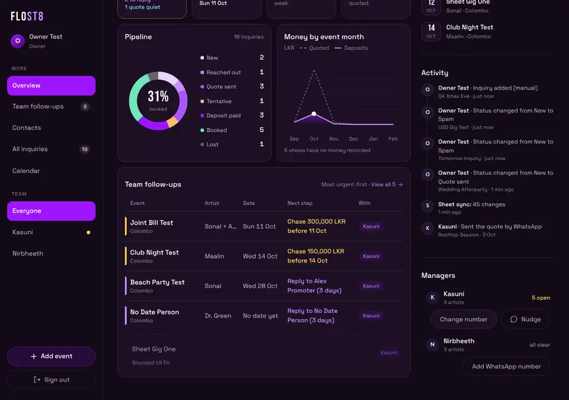

The message lists the next steps. It leaves out phone numbers and emails on purpose.

**Wrong number?** Tap **Change number** next to **Nudge**. Fix the number and tap **Save number**. Or tap **Remove number** to delete it.

**If it goes wrong.**
- The button says **Nothing to nudge** and is grey: that manager has nothing open.
- **Enter the number with digits only...**: fix the number.
- **Saving numbers is not switched on yet.**: your developer must finish the latest database update first.
- **Only the owner can save a number.**: you must be signed in as the owner.

Only you can read these numbers. The managers cannot.

---

## 16. Who can see money

- **You** see money on every event.
- A **manager** sees money only on the events of the artists they look after.
- Everyone else sees **Money details are private to the artist's manager.**
- Totals on the **Overview** and the **All inquiries** bar only add up what the person looking is allowed to see.

---

## 17. Sheet rows: read, move into the app, or delete

**What it is.** Kasuni and Nirbheeth keep Google Sheets. Every 15 minutes the app copies each sheet row in. The row shows a **From sheet** tag.

**What you can do with a sheet row, as it is.**
- Open it and read it.
- Call or WhatsApp the organizer.
- Add a comment.
- Link it to a contact.
- Snooze it.
- Tap **Edit in sheet** to open the sheet.
- Delete it (section 17b).

**What you cannot do, as it is.** Change the status, edit it, or bulk change it. The next copy from the sheet would overwrite your change within 15 minutes.

### 17a. Edit one sheet event in the app

Use this when you want to change a sheet event here, not in the sheet.

1. Open the event. At the top is a yellow note: **From Kasuni's sheet.**
2. Tap **Edit event**.
3. A window **EDIT THIS EVENT?** explains what happens. Read it. Tap **Edit event** again to go on.
4. The event turns into a normal app event and the edit form opens.

**What changes.**
- Only this one event stops syncing from the sheet. All other rows carry on as before.
- Changes made in the sheet no longer show here. Changes made here do not reach the sheet.
- It is **not** put on the public Upcoming Shows list by itself. It is held back. You can tap **Release to website** inside the event when you want it public.
- **This cannot be switched back.**
- If someone later changes that row's date or name in the sheet, the sheet row can show up here again as a new event. If that happens, delete the extra one.

You see **Edit event** on every sheet event. A manager sees it only on events in their own sheet.

### 17b. Delete an event

1. Open the event and scroll to the bottom.
2. Tap **Delete event**.
3. Read the window **DELETE EVENT?** Tap **Delete event** to confirm.

This works on any event: added in the app, from the website form (for example a test or spam enquiry), or from a sheet. The event, its comments and its money details are gone for good. **There is no Undo.**

For a **From sheet** event, the app remembers it and does not bring it back. The row itself stays in the manager's Google Sheet until it is removed there. If someone edits that row's date or name in the sheet later, it can come back as a new event.

A manager can delete only their own events. You can delete any.

---

## 18. Keyboard shortcuts (laptop)

| Key | What it does |
|---|---|
| **/** | Jumps to the search box (on **All inquiries** and **Calendar**) |
| **N** | Opens **Add event** |
| **Up** and **Down arrows** | Move from row to row |
| **Enter** | Opens the row you are on |
| **Esc** | Closes a window or a menu |

They do not work while you are typing in a box, or while a menu or window is open. If an arrow key does nothing, click on an empty part of the page first.

---

## 19. Things only you can do (once)

1. **Add each manager's WhatsApp number** (section 15). Do this once.
2. **Ask your developer to switch on website updates** if you want events to go to Upcoming Shows from the app.
3. **A later step, not now:** switching off the sheet copy for good and moving all the sheet rows into the app in one go. Until then, use **Edit event** one event at a time (section 17a). Do not try the big move inside the app.

---

## Troubleshooting

- **NO ACCESS YET.** That Google account is not on the list. Ask your developer to add it.
- **You can view this but not change it.** It is a sheet row you have not moved into the app (section 17a), or it belongs to someone else.
- **Could not reach the server. Check your internet and try again.** Check your internet. Try again.
- **Something went wrong. Please try again.** Try again. If it keeps happening, tell your developer.
- **A row is missing.** Check the filters. Check **Everyone's**. It may be snoozed, or marked Lost or Spam.
- **Saved, but the website list was not updated.** Tap **Retry**.
- **No Nudge button.** Add the manager's WhatsApp number first.
- **No WhatsApp button on a contact.** The contact has no usable phone number.
- **I tapped by mistake.** Tap **Undo** within 5 seconds. Deleting an event, **Delete forever** and **Edit event** on a sheet row have no Undo.
- **A deleted event came back.** It was a sheet row and its date or name was changed in the sheet, so the app sees it as a new event. Delete it again.

---

## Glossary

- **Needs you / Team follow-ups.** The list of things waiting for a reply or for money. A manager sees **Needs you**. You see **Team follow-ups**.
- **Sheet row.** An inquiry copied in from a manager's Google Sheet. It has a **From sheet** tag.
- **Snooze.** Hide a row from the follow-up lists until a day you pick.
- **Hold back.** Keep an event off the website. Only the owner can release it.
- **Trash.** Where deleted contacts wait. You can restore them. They can be cleared out for good after 30 days, or you can tap **Delete forever** (owner only).
- **Edit event (on a sheet row).** Moves that one event out of the sheet sync and into the app, so you can change it here. It cannot be switched back.
- **Merge.** Join two entries for the same person into one contact.
- **Nudge.** A WhatsApp message to a manager about what is waiting.
- **Booked ahead.** Booked shows that have not happened yet.
- **Still owed.** Money not yet collected for upcoming shows.
