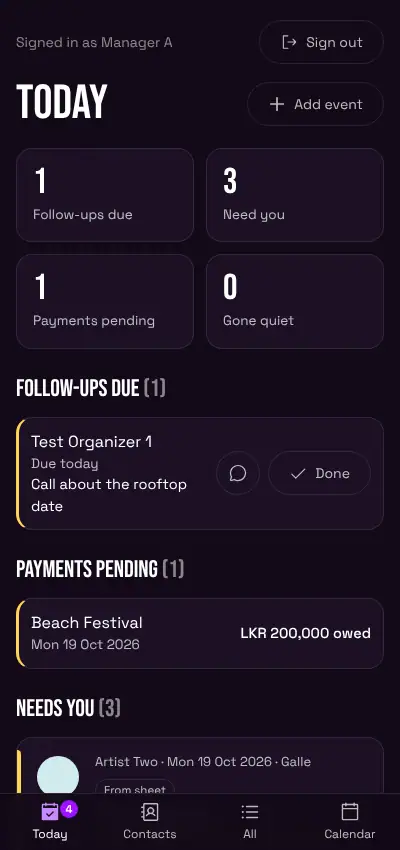
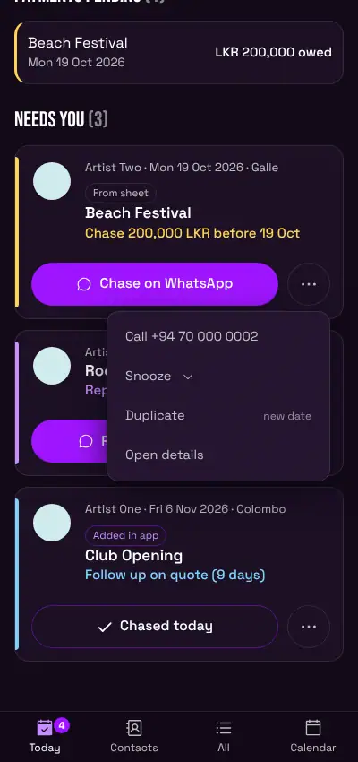
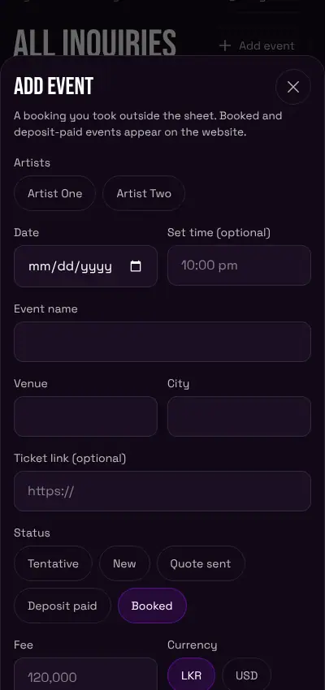
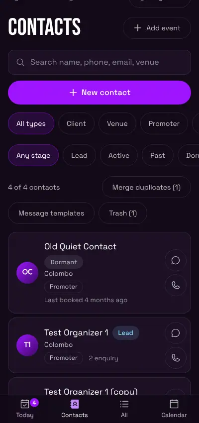
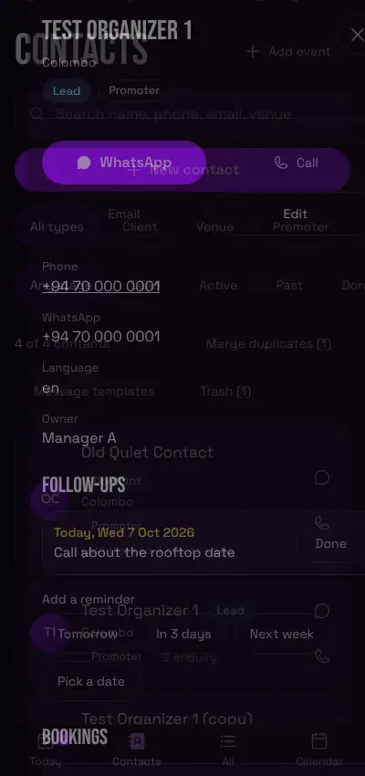
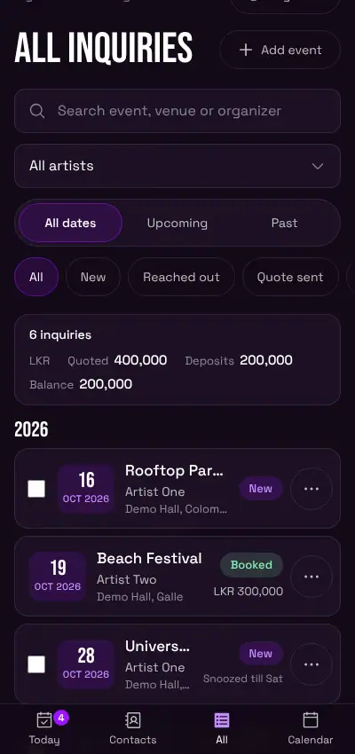
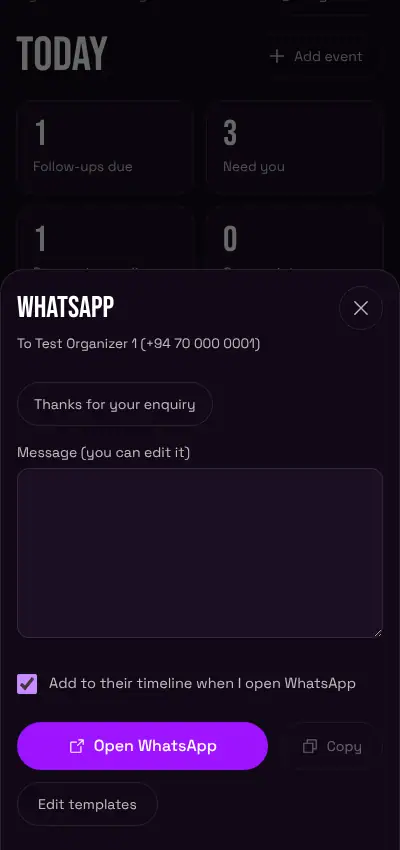

# FLOST8 Bookings: Sales Manager Guide

For Kasuni and Nirbheeth. Plain and simple. Every step here matches what the app does today.

The pictures use made-up names and numbers. Your screen will show your real bookings.

---

## QUICK CARD (read this first)

**What this app is.** One place for your artists' booking enquiries. It tells you who to reply to, who owes money, and who to call back. You see your own artists' events. Anuda (the owner) sees everything.

**How to sign in.**
1. Open the FLOST8 site and go to the page called **/manage**.
2. Tap **Continue with Google**.
3. Pick your Google account.

If you see **NO ACCESS YET**, that Google account is not on the list. Ask Anuda to add your email.

**The 5 things you do every day.**
1. Open **Today**. It is your first screen.
2. Tap **Done** on any **Follow-ups due** that you finished.
3. Clear **Needs you**: tap the big button on each card (WhatsApp, or **Chased today**).
4. After a call, open the contact and write a note under **LOG A TOUCH**. Set a reminder if you need one.
5. Tap **Add event** when you get a new booking.

**Three things to know.**
- Most taps can be undone for 5 seconds. Look for **Undo** at the bottom.
- Rows marked **From sheet** come from your Google Sheet. Change them in the sheet, not here.
- The app never sends a WhatsApp message by itself. It opens WhatsApp and you press send.

---

## 1. Sign in and move around

**What it is for.** Get in, and know where things are.

**What to tap.**
1. Go to **/manage**. Tap **Continue with Google**.
2. Choose your account.

**What you will see.** The **Today** screen.

- On a laptop the menu is on the left: **Today, Contacts, All inquiries, Calendar**.
- On a phone it is the bar at the bottom: **Today, Contacts, All, Calendar**.
- **Add event** and **Sign out** are on the left (laptop) or at the top (phone).
- The app remembers the page you were on and your filters, on that device.

**If it goes wrong.**
- **NO ACCESS YET**: your email is not on the list. Ask Anuda.
- **Loading** that never ends: check your internet and refresh.

---

## 2. The Today screen

**What it is for.** Everything you should do today, in one place.

**What to tap.** Tap **Today**.

**What you will see.**
- Four number boxes: **Follow-ups due**, **Need you**, **Payments pending**, **Gone quiet**.
- **FOLLOW-UPS DUE**: reminders due today or late. Tap **Done** when finished. The chat button opens WhatsApp.
- **PAYMENTS PENDING**: shows with money still owed. Tap one to open it.
- **NEEDS YOU**: events that wait for you (see section 3).
- **GONE QUIET**: people who booked before and have not been in touch for over 90 days. Tap the chat button to message them.

If everything is done you will see **All clear**. Nothing is due today.

**If it goes wrong.** If you see **Contacts could not be loaded, so the lists below may look empty.**, tap **Try again**.

---

## 3. Needs you, and the next-step buttons

**What it is for.** The app tells you what to do next on each event.

**What to tap.** Look at **NEEDS YOU** on **Today**.

**What you will see.** One card per event. Each card has one line that says what to do:
- **Reply to someone**: the event is **New** and has had no touch for more than 24 hours.
- **Follow up on quote**: the status is **Quote sent** and nothing has happened for more than 5 days.
- **Chase money**: the show is **Booked** or **Deposit paid**, it is within 14 days, and money is still owed.

Then one big button:
- **Reply on WhatsApp** or **Chase on WhatsApp**: opens the WhatsApp window with ready messages (see section 8).
- **Chased today**: tap it after you followed up on a quote. The card goes away.

The **three dots** button has more. You only see the ones that fit that card: **Call**, **Chased today**, **Mark reached out**, **Mark paid**, **Set status**, **Snooze**, **Duplicate**, **Open details**.

Every action can be undone for 5 seconds. Tap **Undo** at the bottom.

A **Tentative** date never shows here. Past dates never show here. A card leaves the list when you act on it (a comment, a status change, or a button above).

**If it goes wrong.** **You can view this but not change it** means that event is not yours, or it is a sheet row.

---

## 4. Add an event

**What it is for.** Put a booking you took yourself into the app.

**What to tap.**
1. Tap **Add event**. (On a laptop you can press **N**.)
2. Tap your artist.
3. Pick the **Date**.
4. Type an **Event name** or a **Venue**. You need at least one.
5. Check the **Status**. It starts as **Booked**.
6. In **Organizer**, start typing the name. Tap the match in the list. The phone, email, city and more fill in. (Or tap **Add "name" as a new contact**.)
7. Tap **Add event**.

**What you will see.** The new event opens. It says **Will be added to your list.** Events with the status **Booked** or **Deposit paid** are also sent to the website's Upcoming Shows list.

You can also fill **Set time**, **City**, **Ticket link**, **Fee** and **Currency**.

**If it goes wrong.**
- **Pick at least one artist.** Tap an artist.
- **Pick the event date.** Fill the date.
- **Add an event name or a venue.** Type one.
- **Saved, but the website list was not updated.** Your event is saved. Tap **Retry** on the message. If it keeps happening, tell Anuda.

**Add from the Calendar.** Open **Calendar**. Tap a day. Tap **Add event on** that date. The date is already filled in.

---

## 5. Contacts

**What it is for.** Keep every organizer and venue person in one place.

**What to tap.** Tap **Contacts**.

**What you will see.**
- A search box (name, phone, email, venue).
- Filters: **All types, Client, Venue, Promoter, Artist, Supplier, Sponsor**. And **Any stage, Lead, Active, Past, Dormant**. And **Only mine**.
- **New contact** button.
- Each row has a **WhatsApp** and a **Call** button.

You can see every contact. For each contact you only see the bookings you are allowed to open.

**Add a contact.** Tap **New contact**. Fill in the form. Save.

**Merge two entries for the same person.** In **Contacts**, tap **Merge duplicates**. Tap **Review and merge** on a pair. Pick the one to keep. Tap **Merge**. For 20 seconds you can tap **Undo**. Later, open the kept contact, tap **Show change history**, then **Undo this merge**.

**Delete a contact.** Open it and tap **Move to Trash**. Nothing is erased on its own. After 30 days old ones can be cleared out for good, so restore it before then if you want it back. Get it back with **Contacts**, then **Trash**, then **Restore**.

**If it goes wrong.** If you see **Contacts could not be loaded, so the lists below may look empty.**, tap **Try again**.

---

## 6. Notes, call log and reminders

**What it is for.** Remember what was said, and when to call back.

**What to tap.**
1. Open a contact (tap the name).
2. Under **LOG A TOUCH**, pick **Call**, **WhatsApp**, **Note**, **Meeting** or **Email**.
3. Type what was said in **What was said**.
4. Optional: under **Remind me**, pick **Tomorrow**, **In 3 days**, **Next week** or **Pick a date**.
5. Tap **Save**.

**What you will see.** The note shows under **TIMELINE** with your name and the time. If you set a reminder, it shows under **FOLLOW-UPS**. You can **Delete** your own notes.

**Reminder only.** Under **FOLLOW-UPS**, pick a day, type what to follow up on, and tap **Set reminder**.

**When it is due.** It shows in **FOLLOW-UPS DUE** on **Today**. Late ones are red. Tap **Done** when finished.

**If it goes wrong.** **Save** stays grey until you type something.

---

## 7. All inquiries and filters

**What it is for.** Find any of your events.

**What to tap.** Tap **All inquiries**.

**What you will see.** A list of your artists' events, split by year. The bar at the top shows how many, and the money totals you may see.

**Filters:** the search box, the artist drop-down, **All dates / Upcoming / Past**, and status buttons: **All, New, Reached out, Quote sent, Tentative, Deposit paid, Booked, Lost, Spam**.

**If it goes wrong.** **Nothing matches these filters.** Tap **Show everyone's inquiries**, or loosen the filters.

---

## 8. WhatsApp templates

**What it is for.** Send a ready-made message in a few taps.

**What to tap.**
1. Tap the **WhatsApp** button on a contact or on a card.
2. Pick a language if there is more than one.
3. Tap a template. The message fills in with the name, date and venue.
4. Change the words if you like.
5. Tap **Open WhatsApp**. WhatsApp opens with the message typed. Press send there.

You can also tap **Copy**. If **Add to their timeline when I open WhatsApp** is ticked, the app writes a note on the contact.

**Make or change templates.** In **Contacts**, tap **Message templates**. Tap **New template**. Give it a title, a language and a message. You can type `{name}`, `{date}`, `{venue}`, `{event}` and `{me}`. They fill in by themselves. **Archive** hides one. **Restore** brings it back. Everyone shares the same templates.

**If it goes wrong.** **There is no usable phone number yet** means the contact has no usable number. Add one.

---

## 9. Snooze

**What it is for.** Hide a card from **Needs you** until you want to see it again.

**What to tap.**
1. Tap the **three dots** on the card or row.
2. Tap **Snooze**.
3. Tap **Tomorrow**, **Friday**, or **Pick a date**.

**What you will see.** The card goes away. In **All inquiries** the row says **Snoozed till** that day. On that day it comes back by itself. You get 5 seconds to **Undo**.

To bring it back early: **three dots**, then **Unsnooze**.

Anuda can still see what you snoozed, in a dim colour.

**If it goes wrong.** If you get **Something went wrong**, tell Anuda. One update may still be waiting to be switched on.

---

## 10. Duplicate an event

**What it is for.** Make a new event that is like an old one.

**What to tap.**
1. Tap the **three dots** on the row.
2. Tap **Duplicate**.
3. Pick the new **Date**.
4. Tap **Add event**.

The **Add event** window opens already filled in. It copies your artists, name, venue, city, set time, fee, currency and organizer. It does not copy the date or the ticket link.

---

## 11. Bulk actions

**What it is for.** Close many events at once.

**What to tap.**
1. Open **All inquiries**.
2. Tick the small box at the left of each row.
3. Tap **Mark lost** or **Mark spam** in the bar at the bottom.

**What you will see.** The bar says how many you ticked. You get 5 seconds to **Undo**. Then a message says what happened, for example **7 of 8 updated, 1 not allowed**. Tap **Clear** to untick everything.

**Which rows can you tick?** Only rows that came from the website or that you added in the app, and that are yours. Rows marked **From sheet** have no box.

**If it goes wrong.** **1 not allowed** means one row is not yours. The others still changed.

---

## 12. Change a status

**What it is for.** Move an event forward, or close it.

**Way one.** Tap the **three dots** on the row, tap **Set status**, tap the new status. You get 5 seconds to **Undo**.

**Way two.** Open the event. Tap a status button. A **Tentative** event also has **Confirm booking**.

You cannot change the status of a **From sheet** row. Change it in the sheet.

---

## 13. What you cannot see or do

- You cannot see other managers' bookings. You see your own artists' events.
- You cannot see money for events that are not yours. You will see **Money details are private to the artist's manager.**
- You cannot edit, delete or bulk change a **From sheet** row.
- You cannot change an event that belongs to another manager. You can open it and read it.
- You cannot delete events you did not add in the app.
- Only Anuda can release an event that is held back from the website.
- Only Anuda sees the team buttons, **Resync website** and **Nudge**.

What you can do with a sheet row: open it, read it, call or WhatsApp the organizer, add a comment, link a contact, snooze it, and tap **Edit in sheet** to open your sheet. The app copies your sheet every 15 minutes.

---

## 14. Keyboard shortcuts (laptop)

| Key | What it does |
|---|---|
| **/** | Jumps to the search box (on **All inquiries** and **Calendar**) |
| **N** | Opens **Add event** |
| **Up** and **Down arrows** | Move from row to row |
| **Enter** | Opens the row you are on |
| **Esc** | Closes a window or a menu |

They do not work while you are typing in a box, or while a menu or window is open. If an arrow key does nothing, click on an empty part of the page first.

---

## Troubleshooting

- **NO ACCESS YET.** That Google account is not on the list. Ask Anuda.
- **You can view this but not change it.** It is a sheet row, or it belongs to someone else. This also shows as **not allowed** after a bulk action.
- **Not allowed (in a bulk message).** That row is not yours. The rest were done.
- **Saved, but the website list was not updated.** Your event is safe. Tap **Retry**. If it keeps failing, tell Anuda.
- **Could not reach the server. Check your internet and try again.** Check your internet. Try again.
- **Something went wrong. Please try again.** Try again. If it keeps happening, tell Anuda.
- **A row is missing.** Check the filters. It may be snoozed, or marked Lost or Spam.
- **No WhatsApp button on a contact.** The contact has no usable phone number.
- **I tapped by mistake.** Tap **Undo** within 5 seconds.

---

## Glossary

- **Needs you.** The list of events that wait for you: a reply, a quote follow-up, or money.
- **Team follow-ups.** What Anuda sees instead of **Needs you**. It shows everyone's.
- **Sheet row.** An event copied in from your Google Sheet. It has a **From sheet** tag.
- **Snooze.** Hide a card until a day you pick.
- **Hold back.** Keep an event off the website. Only Anuda can release it.
- **Trash.** Where deleted contacts wait. You can restore them. They can be cleared out for good after 30 days.
- **Merge.** Join two entries for the same person into one contact.
- **Gone quiet.** A person who booked before and has not been in touch for over 90 days.
